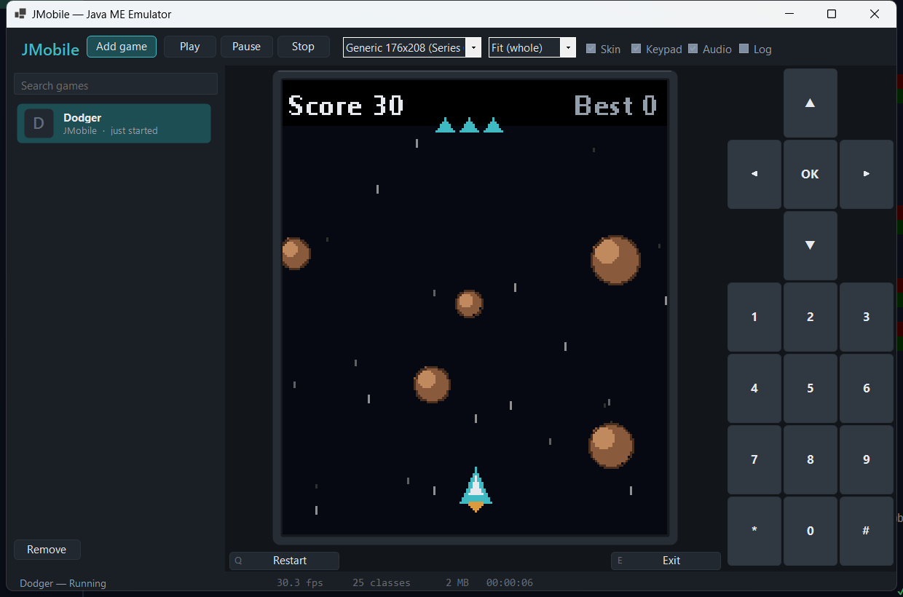

# JMobile

A Java ME emulator for Windows. Drop in a `.jar` and play the game the way the handset ran it.



JMobile implements MIDP 2.0 on CLDC 1.1 — the platform practically every mobile Java game was
built for. It contains a complete JVM written from scratch in C#: a class file parser, a linker, a
bytecode interpreter, real threads, real exceptions. The class library is implemented natively
rather than shipped as compiled Java, so there is no runtime to install and nothing to license.

There are no external package dependencies. A checkout builds with the .NET 9 SDK and nothing
else.

## Quick start

```bash
git clone <this repository>
cd jmobile-emulator

dotnet run --project src/JMobile.App
```

Then drag a `.jar` onto the window, or press **Add game**. Double-click a game to play it.

To open a game straight away:

```bash
dotnet run --project src/JMobile.App -- path/to/Game.jar
```

A sample MIDlet is included at `samples/dodger/Dodger.jar`, which is what the screenshot shows.

## Controls

| Handset | Keyboard | Also |
| --- | --- | --- |
| D-pad | Arrow keys | `W` `A` `S` `D`, or `2` `4` `6` `8` |
| Select / Fire | `Enter` or `Space` | `5`, or the **OK** key on the pad |
| Left soft key | `Q` | Click the label under the screen |
| Right soft key | `E` | Click the label under the screen |
| Keypad `0`–`9` | The matching number keys | Click the pad |
| `*` and `#` | `[` and `]` | Click the pad |
| Clear | `Backspace` | |

Every key is also clickable on the on-screen pad, which matters more than it sounds: J2ME games
routinely bind actions to number keys with nothing on screen to tell you which.

Touchscreen games work too — click and drag on the screen when a touch device profile is selected.

## What works

- **The full JVM instruction set**, including `jsr`/`ret`, which the compilers of the era still
  emitted for `finally` blocks.
- **CLDC 1.1**: `java.lang`, `java.util`, `java.io`, threads, synchronisation, the exception
  hierarchy. `java.util.Random` reproduces Java's generator bit for bit, so seeded level
  generation comes out the same as it did on the phone.
- **MIDP 2.0**: the MIDlet lifecycle, `Display`, `Canvas`, `Graphics`, `Image`, `Font`, commands
  and soft keys, `Form`/`List`/`TextBox`/`Alert`, and the record store.
- **The game package**: `GameCanvas`, `Sprite` with frame sequences, transforms and pixel-level
  collision, `TiledLayer`, `LayerManager`.
- **Nokia extensions** (`com.nokia.mid.ui`), which a large share of the catalogue calls directly
  and without which those games fail before drawing anything.
- **Save data**, kept per game and written through on every change, because these games are
  closed far more often than they are exited.
- **Ten device profiles** from 128x128 to 480x800. A suite that declares the screen it was drawn
  for gets it automatically — running a game built for 480x800 on a 176x208 handset usually
  produces a black screen, since the art is simply drawn off the visible area.

### What does not

MIDI music is silent (WAV plays; `playTone` is synthesised). Networking is HTTP-only and off by
default — the servers these games called are long gone, and the MIDP API blocks, so an enabled
network mostly buys you a frozen game. `Form` and `List` are drawn in this emulator's own look,
since MIDP gives a game no way to observe how they are rendered. `CLAUDE.md` has the full list.

## How it is built

```
src/JMobile.Core       The JVM: class files, loading, linking, interpreter, threads
src/JMobile.Runtime    CLDC + MIDP class library, software rasteriser, PNG decoder
src/JMobile.Emulator   Suite loading, sessions, game library, settings
src/JMobile.App        WinForms shell, GDI font rasteriser, WinMM audio
tests/JMobile.Tests    Conformance, unit and end-to-end tests
samples/dodger         A sample MIDlet, with source
```

Dependencies point strictly downward. The core knows nothing about MIDP; the runtime library
knows nothing about Windows — it asks for a font rasteriser, an audio device and storage through
interfaces, and the desktop shell supplies them.

### Why it is fast

The interpreter is the whole product, so the work went there.

Bytecode is decoded **once** per method into a normalised instruction stream: the forty-odd
`iload_0` / `aload_3` variants collapse into three opcodes with an operand, branch targets become
array indices, `wide` prefixes are folded in, and string literals are interned at compile time.
The dispatch loop never re-parses an operand byte.

A call **copies nothing**. The callee's local variables begin at the slot where its arguments
already sit on the caller's operand stack. Frames are structs in a per-thread array, so an
invocation allocates nothing at all.

The operand stack is **two parallel arrays** — one of primitives, one of references — rather than
one array of tagged values. Integer-heavy code, which is nearly all game code, then never touches
the reference array and never pays a GC write barrier on a push.

Field access is **specialised by width at compile time** from the constant pool, and call sites
carry a monomorphic inline cache, so a `getfield` in a hot loop costs one null check and an array
index.

Presenting a frame **copies nothing either**. The rasteriser's pixel buffer is a plain `int[]`
that the window pins once and hands straight to GDI+ as a bitmap, so the renderer writes into
exactly the memory the screen blits from.

## Testing

```bash
dotnet run --project tests/JMobile.Tests
```

103 tests, no framework dependency. The interesting ones are the **conformance tests**: a Java
fixture is compiled, run on a real JVM, and its output checked in. The suite then runs the same
bytecode through this interpreter and compares. Arithmetic edge cases, `finally` semantics,
interface dispatch, `Random` sequences and string hashing are all pinned to what a real JVM
actually produces rather than to what this implementation happens to do.

The **session tests** launch the sample MIDlet headlessly and assert on the contents of the
framebuffer, which is what catches a game that starts but renders nothing.

```bash
JMOBILE_FRAME_DUMP=./frames dotnet run --project tests/JMobile.Tests
```

writes the captured frames out as PNGs.

## Rebuilding the sample

Only needed if you change it. Requires a JDK on `PATH`.

```bash
pwsh tools/build-sample.ps1
```

The sample compiles against signature-only MIDP stubs in `tests/fixtures/midp-stubs`, generated by
`tools/make-midp-stubs.py`. They stand in for the discontinued Wireless Toolkit and are never
packaged into the JAR — the emulator supplies the real implementations at run time.

## Where your data lives

`%APPDATA%\JMobile` — the game library, save data, and settings. Back it up by copying that one
folder. `--data <path>` puts it somewhere else, which is enough to run a portable install.

## A note on game files

JMobile ships no games and cannot obtain any. It runs `.jar` files you already have. Whether you
have the right to a particular game is between you and whoever holds its copyright.
